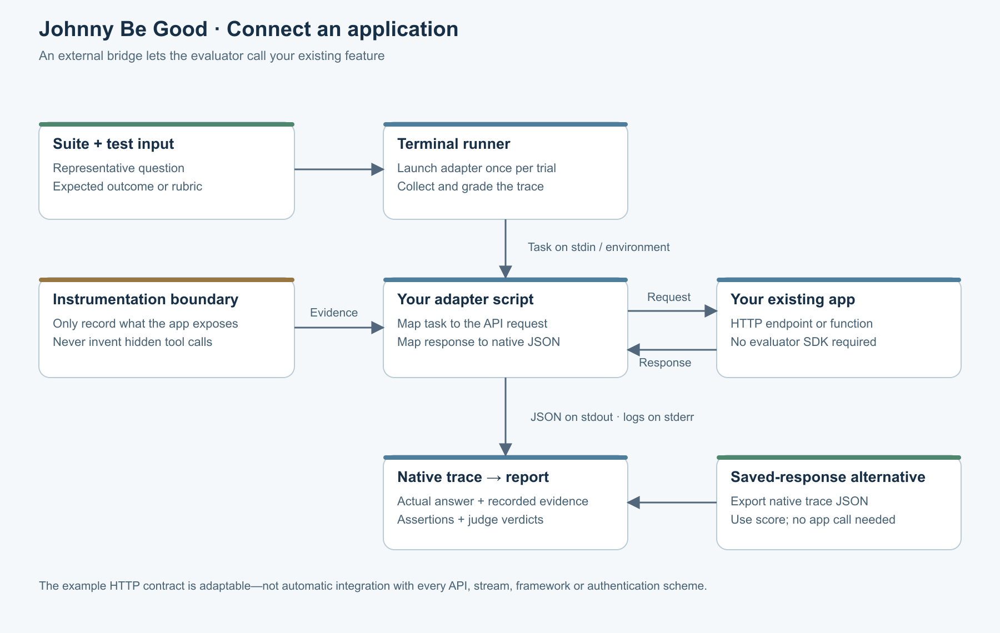
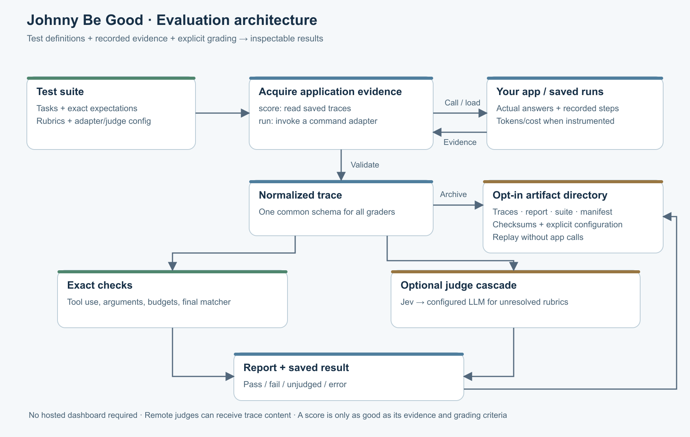

<p align="center">
  
</p>

# Johnny Be Good

**A terminal test runner for AI applications: check what happened, grade the answer, and see why a run failed.**

Run it beside your app or against saved responses. Your production app does not need to import this package. No dashboard, hosted evaluation service or database is required. An application bridge and useful test cases are required; the tool cannot inspect an arbitrary app automatically.

This project was previously named Trace Check. Existing `tracecheck` CLI usage and the `TRACECHECK_*` adapter environment contract remain supported. The GitHub repository URL is still `juaninamilliom/tracecheck`.

## Start here

1. [Run the no-key example](#1-run-your-first-evaluation-no-keys-required).
2. [Connect your application](#2-connect-your-application).
3. [Define success](#3-write-test-cases-and-expected-outcomes).
4. [Understand files and reports](#4-understand-what-is-stored).
5. [Add a model judge](#5-add-judgment-only-where-needed).
6. [Calibrate, compare and repeat](#6-measure-your-graders-and-detect-regressions).

## 1. Run your first evaluation (no keys required)

Use Node.js 22+ and npm. Node 20 is the base package minimum; the optional Jev SDK needs Node 22. From a terminal:

```sh
git clone https://github.com/juaninamilliom/tracecheck.git
cd tracecheck
npm ci --ignore-scripts
npm run --silent cli -- score examples/weather/suite.yaml --no-judges --verbose
```

`--ignore-scripts` skips the package preparation build. The checkout command runs TypeScript source through the development runner; no application build is needed. For subsequent commands, stay in the repository root. After installing the CLI package, use `johnny-be-good` in place of `npm run --silent cli --`.

The Lisbon example has two recorded runs:

- The good trace called `get_weather` correctly and passes its exact checks.
- The bad trace used `search_web` and fails the required-tool check.
- Rubric questions stay **UNJUDGED** because `--no-judges` disables model judging.

**Exit code 1 is expected here.** The example deliberately includes a failure. Passing exact checks does not mean an unjudged run fully passed. No app or model is called by this offline command; usage displayed in the trace is historical fixture data.

Color is enabled for supported terminals. Use `--color always` to force it or `--color never` to disable it. `NO_COLOR` disables automatic color; an explicit color flag takes precedence. `--json` emits machine-readable results without styling or progress output.

## 2. Connect your application

Choose the path that matches what you can access:

| Your starting point | Integration | What can be evaluated |
| --- | --- | --- |
| Saved responses or agent runs | Export native traces, then use `score` | Whatever the saved evidence contains |
| An HTTP endpoint | A small command adapter calls it | Answer quality; internal behavior only if your app returns recorded steps/context |
| An internal function or SDK | A command adapter imports and calls your function | The function output and evidence you instrument |
| A Claude Code agent | Import its transcript or use the `claude-code` adapter | Recorded messages, tool calls/results and final answer |



### Try a complete local HTTP example

In terminal one:

```sh
node examples/http-app/demo-server.mjs
```

In terminal two, from this repository root:

```sh
npm run --silent cli -- run examples/http-app/suite.yaml --no-judges --verbose
```

Both exact-answer tests should pass. This server is a **fictional, deterministic fixture**, not an LLM. It proves the adapter/runner wiring without provider keys or inference charges.

Next, follow the [HTTP integration walkthrough](examples/http-app/README.md): point the bridge at your development endpoint, map your API's input/output fields, and replace the sample cases. The documented example contract is `POST {"input":"..."}` → `{"answer":"..."}`; it is not a universal requirement for your application. Change the bridge for your contract.

The command adapter receives the task on stdin and in `TRACECHECK_TASK`; `TRACECHECK_CASE` and `TRACECHECK_RUN` identify the case and repetition. It prints one normalized trace on stdout. Application diagnostics belong on stderr. The suite's command is trusted executable configuration—do not run untrusted suites against your machine or production services.

Your app can stay separate from the evaluation tool. It may run locally or remotely, but it must be reachable. A test endpoint is optional if a bridge can call an existing endpoint or internal function. No automatic instrumentation, streaming API conversion, auth setup or environment reset is implied.

## 3. Write test cases and expected outcomes

An eval has **an input, evidence, and a definition of success**. It does not always need one exact reference sentence.

### Exact outcomes

```yaml
suite: arithmetic
judges:
  jev: false
  llm: false
cases:
  - id: two-plus-two
    task: What is 2 + 2? Reply with only the number.
    trace: traces/two-plus-two.json
    expect:
      - final: { equals: "4" }
```

A native trace for that saved response:

```json
{
  "version": 1,
  "id": "two-plus-two-run-1",
  "task": "What is 2 + 2? Reply with only the number.",
  "steps": [],
  "final": "4"
}
```

Create the files relative to your suite and run `npm run --silent cli -- score path/to/suite.yaml --no-judges`. An empty `steps` array means no internal actions were recorded; it does not prove no actions occurred. Supply real token/cost usage when you have it. Missing or partial instrumentation is displayed as unknown/partial rather than measured zero. Numeric counters remain in the data format for compatibility; token and cost coverage are reported separately. A reported cost is not a billing guarantee.

### Tool behavior

When your trace contains real tool instrumentation, add assertions such as:

```yaml
expect:
  - toolCalled: get_weather
    args: { city: Lisbon }
    times: { min: 1, max: 1 }
  - toolNotCalled: send_email
  - maxToolCalls: 5
  - noToolErrors: true
```

A correct-looking final answer can still fail a required-tool or forbidden-action check. Conversely, an answer-only trace cannot support claims about hidden tools, retrieval or grounding.

### Open-ended quality

Use rubric questions for judgments that code cannot determine from a literal match:

```yaml
rubric:
  - id: supported-answer
    kind: noul
    question: >-
      Reference policy: refunds are allowed within 30 days with a receipt.
      Does the answer accurately explain that policy without adding unsupported rules?
```

Use reference material representative of your application, and ensure it is included in the trace or question. `noul` is a yes/no probability-style judgment; `score` uses ordered criteria; `choice` selects a named label. These are model verdicts, not guaranteed truth. A rubric can be wrong or ambiguous—inspect disagreements with human labels.

## 4. Understand what is stored

| Item | Contents | How it is used |
| --- | --- | --- |
| Suite YAML/JSON | Tasks, assertions, rubrics, adapter and judge settings | Defines the experiment |
| Native trace JSON / imported JSONL | App response, recorded steps and available usage | Evidence that can be scored again |
| Human-label YAML | Rubric IDs and a person's pass/fail judgments on traces | Measures judge agreement |
| Result JSON | Statuses, assertion diagnostics, judge verdicts, metrics and available cost | Inspect results and compare a baseline |

Keep non-sensitive test definitions in version control. Save local artifacts under the ignored `.tracecheck` directory, or another private location:

```sh
mkdir -p .tracecheck
npm run --silent cli -- score examples/weather/suite.yaml --no-judges --out .tracecheck/weather-results.json
```

A result report and a normalized response trace are different artifacts. `--out` saves the report. To archive evidence and experiment metadata, use a **new** directory for each run:

```sh
npm run --silent cli -- run examples/http-app/suite.yaml --no-judges --target-version demo-v1 --artifacts .tracecheck/http-001
```

The directory contains `manifest.json`, `suite.json`, `report.json`, normalized trace files and per-run results. The manifest records checksums, tool version, explicit judge configuration, available dataset fingerprints and the supplied non-secret target revision. It does not capture your entire application environment or automatically pin remote model behavior. Omit secrets from `--target-version` and configuration metadata. Existing directories are refused instead of overwritten.

After stopping the app, regrade its saved responses:

```sh
npm run --silent cli -- replay .tracecheck/http-001 --no-judges
```

Replay verifies recorded artifacts and does not execute the saved app adapter. Judges are off by default during replay, even if provider keys exist. An explicit `--llm` or `--model` opts into regrading with a model judge and can send saved trace content to that provider. Add `--artifacts .tracecheck/http-regrade-001` to save a new experiment without modifying the original. Incomplete experiments or corrupted artifacts are rejected.

Capturing is opt-in: without `--artifacts`, live runs are not automatically archived. The archive contains the normalized evidence the bridge supplied—not unrecorded app internals or necessarily the original raw transcript. [Architecture and checked source map](docs/architecture.md) explains the storage boundary.

Recorded responses can contain user data, retrieved documents, credentials or private tool results. Redact deliberately before storing or sending traces to judges. Private evaluation data should not become public just because test code is in Git.

## 5. Add judgment only where needed

Exact assertions need no model. Rubric questions use the configured judge cascade:

1. Jev can answer first when configured or when `TYPESAFE_API_KEY` is present.
2. Uncertain questions can escalate to the configured LLM judge.
3. Questions no judge answers remain **UNJUDGED**, never a silent pass.

For a local judge, install/start Ollama separately and obtain the desired model. Then:

```sh
npm run --silent cli -- score examples/weather/suite.yaml --model llama3.1
```

The default LLM provider is Ollama. For hosted Claude judging, configure the appropriate Anthropic credentials in your process environment and select `--llm anthropic --model <accessible-model-id>`. Optional SDK installation and current model access are separate requirements. `judges: { jev: false, llm: false }` disables both tiers in a suite; `--no-judges` disables judges for a score/run command.

Hosted judges receive rendered trace content, subject to the configured truncation budget. A local CLI does not mean all data stays local. Your application may also call a paid model even when evaluation judges are disabled. Configure recipients and budgets before using private traces. Prompt boundaries and clipping do not eliminate judge prompt-injection or missing-context risks.

## 6. Measure your graders and detect regressions

First, label examples yourself. Keep threshold-tuning data separate from final held-out checks. A tiny demonstration set can expose a bug, but cannot establish broad evaluator accuracy.

```yaml
# labels.yaml
rubrics:
  - { id: answered, kind: noul, question: Did the answer address the user's question? }
items:
  - { trace: traces/good.json, labels: { answered: true } }
  - { trace: traces/bad.json, labels: { answered: false } }
```

```sh
npm run --silent cli -- calibrate path/to/tuning-labels.yaml --held-out path/to/validation-labels.yaml --model llama3.1
```

Use an installed local model name in place of `llama3.1` if yours differs. Both label files must use identical rubric definitions and distinct trace IDs/content. Changing only a trace ID does not make a tuning example independent validation data. The tool chooses a threshold on the tuning split, freezes it, then evaluates held-out labels once. It reports coverage, confusion counts, disagreements, failures and sample counts. Trace-level uncertainty is reported under the stated sampling assumptions; a small or biased dataset still cannot establish general quality.

Without `--held-out`, calibration is explicitly an in-sample exploration. Do not report a tuning recommendation as held-out accuracy or cost optimality. Pin model/configuration and record the data used. Repeatedly adjusting settings to fit the same held-out results contaminates that evaluation; use a fresh validation set after policy changes.

For live application testing, repeat cases:

```sh
npm run --silent cli -- run examples/http-app/suite.yaml --runs 3 --no-judges
```

For regression comparison, save a baseline and compare a later report:

```sh
mkdir -p .tracecheck
npm run --silent cli -- run examples/http-app/suite.yaml --no-judges --out .tracecheck/baseline.json
npm run --silent cli -- run examples/http-app/suite.yaml --no-judges --baseline .tracecheck/baseline.json
```

Keep dataset, application version, model, judge configuration and environment comparable before interpreting a difference. A baseline report is not an experiment-reproducibility guarantee. Uniform repetition counts are needed for a single meaningful pass-every-run metric. With mixed counts, the report labels the mixture and groups pass-every-run results by trial count rather than claiming one common pass^k.

## Commands and exit codes

| Command | Purpose |
| --- | --- |
| `score <suite>` | Grade saved traces without rerunning the application |
| `run <suite>` | Call the suite's adapter for fresh application outputs |
| `replay <experiment-dir>` | Regrade archived responses without rerunning the application; judges off unless explicitly selected |
| `import <transcript> --out <file>` | Convert a Claude Code transcript to a native trace |
| `calibrate <labels>` | Compare judges with human labels and inspect a threshold sweep |

Common flags: `--verbose`, `--json`, `--only a,b`, `--runs 3`, `--concurrency 2`, `--out <report.json>`, `--baseline <report.json>`, `--no-judges`, `--llm <provider>`, `--model <id>`, `--color auto|always|never`, `--artifacts <new-dir>`, `--target-version <revision>`, and `--held-out <labels>` for calibration. Use `npm run --silent cli -- --help` for the current CLI contract. Trace paths and adapter `cwd` resolve relative to the suite; CLI output/artifact paths resolve from the terminal's current directory.

For `score`, `run` and `replay`: exit **0** means all cases passed; **1** means a failure, error or regression; **2** means only unjudged cases prevented a pass. For calibration, exit **0** means the measurement completed without reported failures or unanswered held-out labels—not that a quality threshold was met. No minimum-agreement release gate is implied. The demonstration's expected failure is not an installation error.

## Architecture, verification and limits



[Architecture and checked source map](docs/architecture.md) explains file storage, trust boundaries, judge routing and what is not automatically captured. [Configuration reference](docs/reference.md) lists assertions, rubric types and adapter/judge options. [Technical design](docs/design.md) provides the earlier rationale. [HTTP example](examples/http-app/README.md) is the runnable integration guide. Editable SVGs live beside the PNGs.

Run development checks without a build:

```sh
npm run typecheck
npm test -- test/cli.test.ts test/report.test.ts test/runner.test.ts test/assertions.test.ts test/adapters.test.ts test/calibrate.test.ts test/heldout-calibration.test.ts test/artifacts.test.ts test/reliability.test.ts test/usage.test.ts test/http-app.test.ts
```

Tests using fake clients or a fictional HTTP endpoint establish the tested caller behavior—not live provider access, model quality or production readiness. Full instrumentation, correct rubrics, representative datasets, environment isolation, versioned experiments and held-out judge validation are requirements for trustworthy use, not guarantees supplied by a colorful report.

## License

MIT
