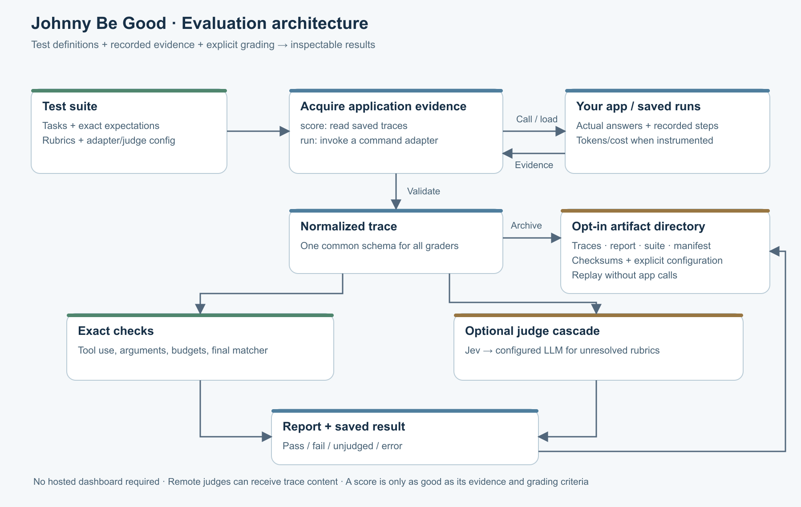
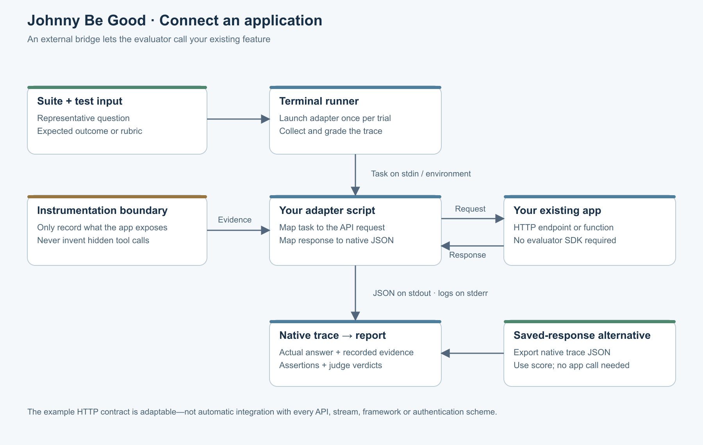

# Johnny Be Good architecture

Johnny Be Good is a file-based evaluation runner. It acquires application evidence, normalizes it into a trace, applies exact assertions and optional rubric graders, and reports the combined outcome. An external command bridge is the application integration boundary; embedding the library is optional. No UI, hosted service or database is required by the runner.

## Boundaries

| Boundary | Owner / responsibility | Contract |
| --- | --- | --- |
| Test definitions | The application team | Suite YAML/JSON: tasks, assertions, rubrics and adapter/judge settings |
| Application bridge | The application team | Task on stdin/environment; native trace JSON or supported Claude Code output on stdout |
| Trace normalization | Importer/schema | Validate messages, recorded tool calls/results, final answer and available usage |
| Exact grading | Assertion code | Check facts present in the recorded trace; no model required |
| Subjective grading | Explicit judge configuration | Judge cascade returns verdicts, tier provenance and failure information |
| Result storage | CLI / experiment workflow | Report JSON and explicit recorded evidence; not a hidden database |

The HTTP example uses a specific request/response contract and must be adapted for another application. An answer-only endpoint supports answer evaluation; it cannot expose hidden internal tool calls or retrieved context. A command adapter may import an internal function instead of calling HTTP. An app's existing LLM provider does not have to be the same provider used as an evaluation judge.

## Data model

A suite defines **what to test**. A trace records **what happened**. Human labels record **how people judge that evidence**. A report records **how this evaluator graded it**. These are separate artifacts with different lifecycles.

For saved runs, `score` loads trace files relative to the suite. For live runs, `run` starts the configured adapter per case/trial. Native traces contain `steps` and may include a final answer, model, usage and metadata. Do not substitute fabricated tool activity for missing instrumentation. The current schema defaults missing token counters to zero; that is not evidence of measured zero usage.

Store non-sensitive suites and reference expectations in version control. Keep private responses, traces and local reports in `.tracecheck` or another private artifact location. A report's verdicts and diagnostics do not substitute for response traces. `--out` writes a report. `--artifacts <new-dir>` opts into recording normalized traces, per-run results, a replay-safe suite snapshot and report with checksums in a manifest. Existing directories are refused. Trace/configuration files are private local artifacts, not an automatic public upload.

`replay <dir>` validates archived evidence and regrades it without invoking the saved adapter. Replay defaults to no model judges; an explicit model/provider selection is required to add them. Invalid checksums or incomplete experiments are rejected. Replay reproduces scoring on saved evidence, not a fresh stochastic application outcome.

Manifests record tool version, explicit judge configuration, input/suite hashes and optional non-secret target revision. Ambient environment, hidden app configuration and remote model weights are not captured. A recorded default/alias model is not necessarily an immutable model version. Captured traces contain only evidence provided by the bridge, not unrecorded application internals.

## Grading and trust

Exact checks and rubric checks both contribute to run status. A required tool call can fail even when the final sentence looks plausible. A model judge's unavailability is visible and unresolved rubric questions remain unjudged. Baseline comparison treats lost passes or falling run pass rates as regressions.

Jev is an optional first tier. Questions it leaves undecided escalate to the configured LLM tier. A model's confidence, a high agreement score on tuning examples, and a passing fixture are different forms of evidence. None alone establishes general model or grader correctness.

The evaluator process inherits the environment and can execute suite commands. Treat suites/adapters as trusted code. Remote model judges receive rendered trace content; truncation and instruction boundaries are mitigations, not guarantees of complete context or prompt-injection resistance. Redact private data and configure judge recipients deliberately. Live app calls may incur costs even with evaluator judges disabled.

## Current decisions and consequences

- **One normalized trace:** keeps assertions/judges independent of app frameworks. Each new app still needs an exporter or bridge.
- **Code for exact facts:** avoids asking a model to count tool calls or enforce simple budgets. Evidence quality limits what those checks can prove.
- **Explicit judge cascade:** can reduce expensive fallback calls. Thresholds need empirical validation. `calibrate --held-out` freezes the tuning-selected threshold before evaluating disjoint held-out traces with identical rubric definitions.
- **File-based operation:** keeps local workflows inspectable and versionable. Experiment identity, recorded live evidence and replay use explicit opt-in artifacts rather than an implicit database. Private content is not automatically de-identified.
- **Terminal-first presentation:** provides readable status distinctions while preserving JSON/redirected output. Presentation is not a substitute for evaluator validity.

## Checked source evidence

The following literal anchors were rechecked when this document was introduced. Read surrounding implementations before relying on them; refresh anchors when behavior moves.

- `src/suite.ts:57`: ``task: z.string().optional(),``
- `src/suite.ts:63`: ``expect: z.array(AssertionSchema).default([]),``
- `src/trace/schema.ts:43`: ``steps: z.array(StepSchema),``
- `src/trace/schema.ts:45`: ``usage: UsageSchema.default({ inputTokens: 0, outputTokens: 0, cacheReadTokens: 0, cacheWriteTokens: 0 }),``
- `src/adapters/adapters.ts:83`: ``const env = { ...process.env, TRACECHECK_TASK: c.task, TRACECHECK_CASE: c.id, TRACECHECK_RUN: String(run + 1) };``
- `src/adapters/adapters.ts:90`: ``res = await spawner(cmd, args, { cwd, env, input: c.task, timeoutMs: cfg.timeoutMs, shell });``
- `src/importers/index.ts:28`: ``return { ...parsed.data, meta: { ...parsed.data.meta, usageProvided: hasRecordedTokenUsage(source) } };``
- `src/runner/runner.ts:157`: ``const assertions = [...(suite.defaults?.expect ?? []), ...c.expect].map((a) => runAssertion(trace, a));``
- `src/runner/runner.ts:162`: ``const unjudged = cascade.rubric.some((r) => r.status === "unjudged");``
- `src/judges/index.ts:19`: ``if (jev !== false && (jev || env.TYPESAFE_API_KEY)) {``
- `src/cli/main.ts:182`: ``if (values.out) await writeFile(values.out, `${JSON.stringify(result, null, 2)}\n`);``
- `src/runner/artifacts.ts:113`: ``await mkdir(destination, { mode: 0o700 }); // Refuse every pre-existing directory, including an empty one.``
- `src/runner/artifacts.ts:133`: ``if (manifest.version !== 1 || manifest.complete !== true || !Array.isArray(manifest.runs)) throw new Error("Only complete version-1 experiments can be replayed");``
- `src/calibrate/calibrate.ts:314`: ``if (seenContent.has(content)) throw new Error("Duplicate or overlapping trace content; metadata/ID changes do not make a new held-out example");``

## Verification and limits

The documented HTTP fixture is deliberately deterministic and local. Its end-to-end checks establish that known answers can pass and wrong answers fail through the actual CLI/adapter path. They do not evaluate an LLM. Source type checks and reviewed focused tests are the development gate; no production build is part of this workflow. Live provider access, representative application datasets, meaningful reference labels and model/judge quality need their own evidence.

See [the README](../README.md) for user workflows, [the HTTP example](../examples/http-app/README.md) for a runnable bridge, and [the earlier technical design](design.md) for historical rationale.
